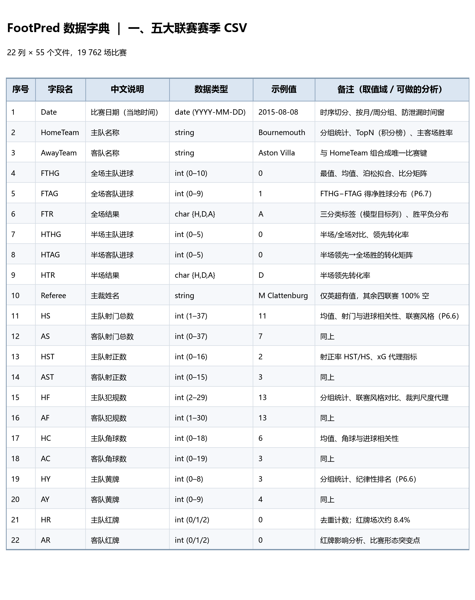
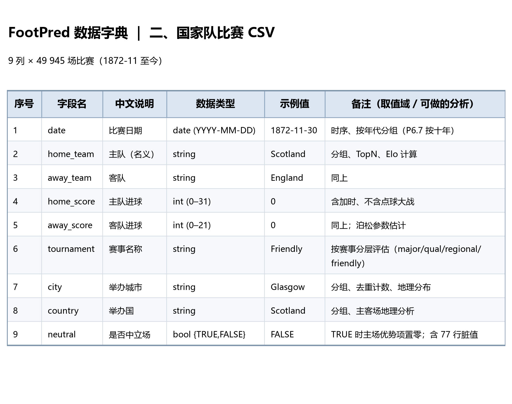
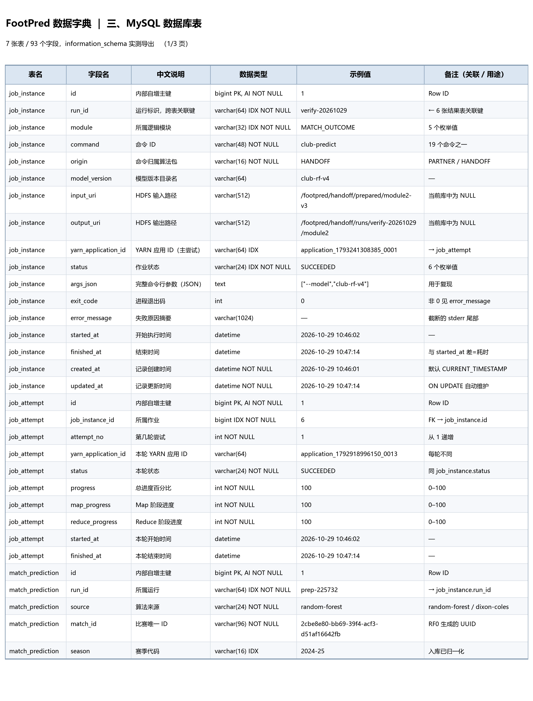
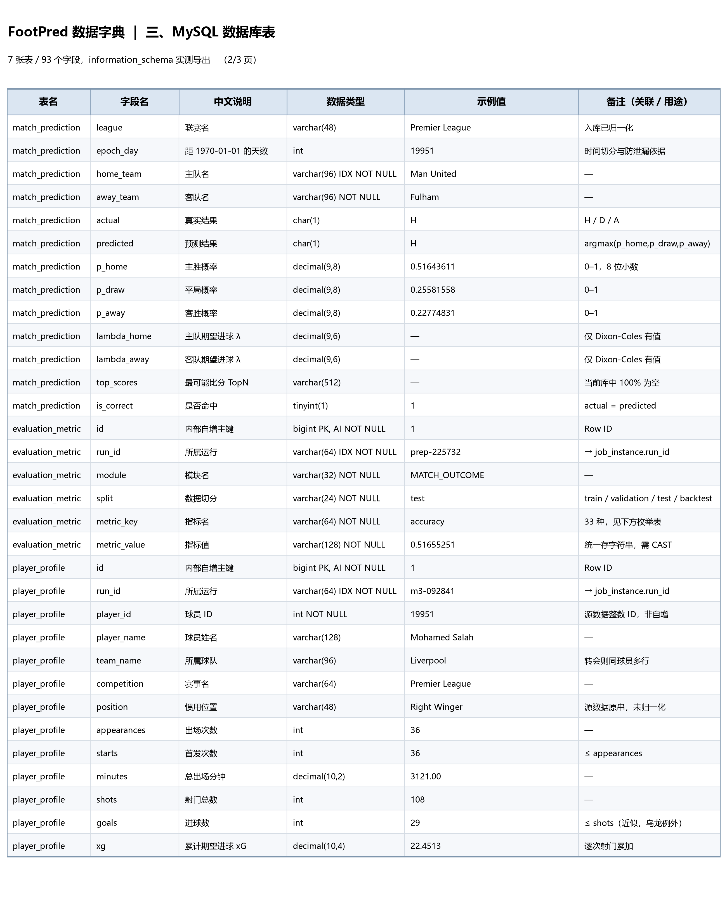
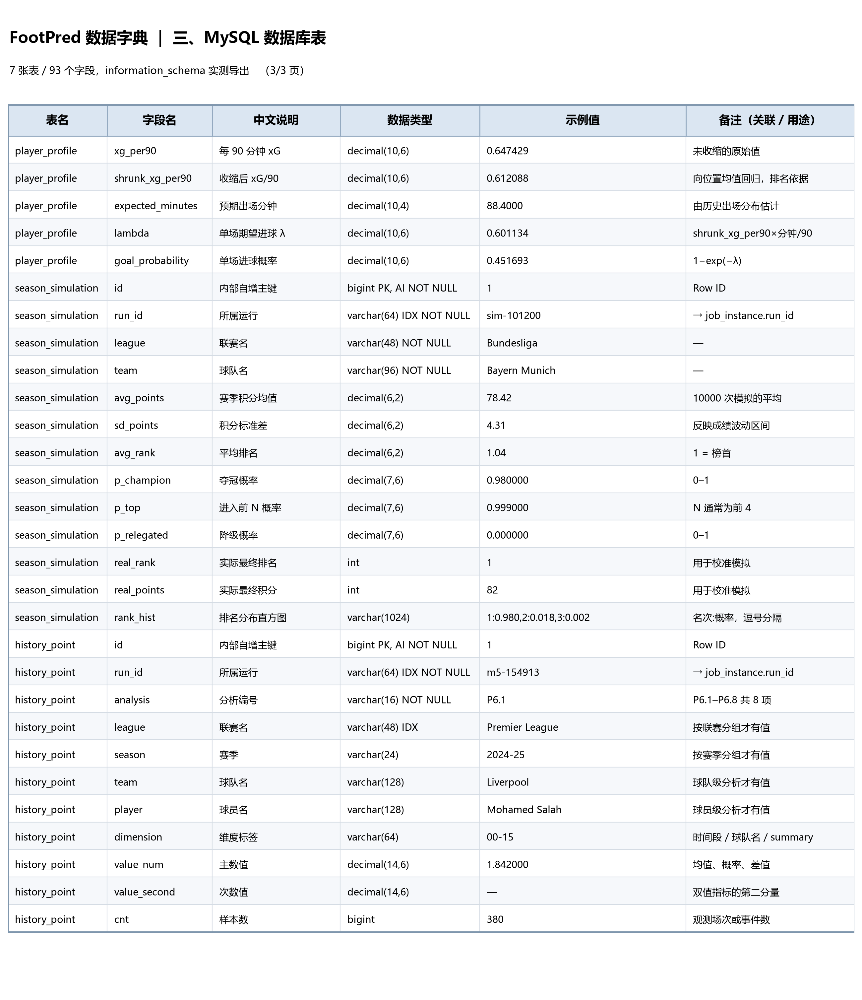

# FootPred 数据字典

对应课程要求 §2「Data Dictionary：为数据文件的所有列设计数据字典，清楚描述每个字段的含义
及可进行的分析类型（去重、最值、分组统计、TopN 等）」。

本文档按「一表一长表」的方式组织：每张表一张六列表格，列含义如下。

| 列 | 含义 |
|---|---|
| 表名 | 该字段所属的表（或数据文件） |
| 字段名 | 列的原始名称，与源文件表头或数据库列名完全一致 |
| 中文说明 | 字段的业务含义 |
| 数据类型 | 源文件的逻辑类型，或数据库的实际类型（含 PK / UK / IDX / NOT NULL 标记） |
| 示例值 | 取自真实数据的一条样本 |
| 备注（关联 / 用途） | 外键关联、取值域、空值情况、可做的分析类型 |

**数据规模实测**（2015/16–2025/26 五联赛 55 个文件 + 国家队全历史）：

| 数据源 | 记录数 | 列数 |
|---|---:|---:|
| 五大联赛 CSV | 19 762（55 文件，已扣表头） | 22 |
| 国家队 CSV | 49 945 | 9 |
| 合计有效记录 | **69 707** | — |

---

## 一、五大联赛赛季 CSV（22 列 × 55 文件）

**来源**：football-data.co.uk（经 `datasets/football-datasets` 分发），PDDL 1.0 许可。
**位置**：HDFS `/footpred/handoff/input/five-leagues/<league>/season-<YYZZ>.csv`
**枚举**：league ∈ {premier-league, la-liga, bundesliga, serie-a, ligue-1}，每联赛 11 个赛季。



| 序号 | 字段名 | 中文说明 | 数据类型 | 示例值 | 备注（取值域 / 可做的分析） |
|---|---|---|---|---|---|
| 1 | `Date` | 比赛日期（当地时间） | date (YYYY-MM-DD) | 2015-08-08 | 时序切分、按月/周分组、防泄漏时间窗 |
| 2 | `HomeTeam` | 主队名称 | string | Bournemouth | 分组统计、TopN（积分榜）、主客场胜率 |
| 3 | `AwayTeam` | 客队名称 | string | Aston Villa | 与 HomeTeam 组合成唯一比赛键 |
| 4 | `FTHG` | 全场主队进球 | int (0–10) | 0 | 最值、均值、泊松拟合、比分矩阵 |
| 5 | `FTAG` | 全场客队进球 | int (0–9) | 1 | FTHG−FTAG 得净胜球分布（P6.7） |
| 6 | `FTR` | 全场结果 | char {H,D,A} | A | 三分类标签（模型目标列）、胜平负分布 |
| 7 | `HTHG` | 半场主队进球 | int (0–5) | 0 | 半场/全场对比、领先转化率 |
| 8 | `HTAG` | 半场客队进球 | int (0–5) | 0 | 半场领先→全场胜的转化矩阵 |
| 9 | `HTR` | 半场结果 | char {H,D,A} | D | 半场领先转化率 |
| 10 | `Referee` | 主裁姓名 | string | M Clattenburg | 仅英超有值，其余四联赛 100% 空 |
| 11 | `HS` | 主队射门总数 | int (1–37) | 11 | 均值、射门与进球相关性、联赛风格（P6.6） |
| 12 | `AS` | 客队射门总数 | int (0–37) | 7 | 同上 |
| 13 | `HST` | 主队射正数 | int (0–16) | 2 | 射正率 HST/HS、xG 代理指标 |
| 14 | `AST` | 客队射正数 | int (0–15) | 3 | 同上 |
| 15 | `HF` | 主队犯规数 | int (2–29) | 13 | 分组统计、联赛风格对比、裁判尺度代理 |
| 16 | `AF` | 客队犯规数 | int (1–30) | 13 | 同上 |
| 17 | `HC` | 主队角球数 | int (0–18) | 6 | 均值、角球与进球相关性 |
| 18 | `AC` | 客队角球数 | int (0–19) | 3 | 同上 |
| 19 | `HY` | 主队黄牌 | int (0–8) | 3 | 分组统计、纪律性排名（P6.6） |
| 20 | `AY` | 客队黄牌 | int (0–9) | 4 | 同上 |
| 21 | `HR` | 主队红牌 | int (0/1/2) | 0 | 去重计数；红牌场次约 8.4% |
| 22 | `AR` | 客队红牌 | int (0/1/2) | 0 | 红牌影响分析、比赛形态突变点 |

### 1.1 关键约束（数据质量规则）

以下四条均由**实际数据处理中发现**，不是教科书假设：

1. **`HST ≤ HS` 且 `AST ≤ AS`** 恒成立（实测 5 联赛 1516 赛季 0 违规）。
   本项目早期版本曾把列索引错写成 11/12/13/14（误读为 `AS/HST/AST/HF`），
   导致 **92.1% 的行违反该约束**——正是靠这条规则才定位到错误。
2. **`Referee` 只在英超填充，其余四联赛整列为空**。
   任何涉及裁判的分析必须限定在英超子集，不能跨联赛做「裁判尺度排名」。
3. **`Referee` 字段本身不含引号内逗号**（实测英超 19 个裁判名均为 `A Marriner` 形式），
   但同源旧数据中存在 `"Wiley, A. G."` 形式，解析器仍按支持引号的 CSV 实现。
4. **技术统计列在早期赛季可能为空**，空值必须保留为缺失而非置 0，
   否则会算出「场均犯规 0 次」的假结论。

### 1.2 可做的分析类型汇总

| 分析类型 | 适用字段 | 对应 Job |
|---|---|---|
| 去重 / 计数 | 全部（按 `Date+HomeTeam+AwayTeam` 生成 UUID） | RF0 清洗 |
| 最值 / 分布 | `FTHG`, `FTAG` | P6.7 分差分布 |
| 分组统计 | `HomeTeam`, `AwayTeam`, `league+season` | P6.1 冠军演变、P6.2 主场优势、P6.6 联赛风格 |
| 时序 | `Date` | RF1 时序特征（防泄漏）、P6.2 年代趋势 |
| TopN | `HomeTeam` 按积分 | P6.1 每赛季冠军 |
| 关联 / 交叉 | `HomeTeam × AwayTeam` | P6.4 H2H 对战矩阵 |
| 分桶统计 | 进球发生时间段 | P6.3 进球时段分布 |
| 机器学习特征 | 全部数值列 | RF1 生成 73 维赛前特征 |

---

## 二、国家队比赛 CSV（9 列 × 49 945 行）

**来源**：martj42/international_results，CC0 许可。
**位置**：HDFS `/footpred/handoff/input/international/results.csv`



| 序号 | 字段名 | 中文说明 | 数据类型 | 示例值 | 备注（取值域 / 可做的分析） |
|---|---|---|---|---|---|
| 1 | `date` | 比赛日期 | date (YYYY-MM-DD) | 1872-11-30 | 时序、按年代分组（P6.7 按十年） |
| 2 | `home_team` | 主队（名义） | string | Scotland | 分组、TopN、Elo 计算 |
| 3 | `away_team` | 客队 | string | England | 同上 |
| 4 | `home_score` | 主队进球 | int (0–31) | 0 | 含加时、不含点球大战 |
| 5 | `away_score` | 客队进球 | int (0–21) | 0 | 同上；泊松参数估计 |
| 6 | `tournament` | 赛事名称 | string | Friendly | 按赛事分层评估（major/qual/regional/friendly） |
| 7 | `city` | 举办城市 | string | Glasgow | 分组、去重计数、地理分布 |
| 8 | `country` | 举办国 | string | Scotland | 分组、主客场地理分析 |
| 9 | `neutral` | 是否中立场 | bool {TRUE,FALSE} | FALSE | TRUE 时主场优势项置零；含 77 行脏值 |

### 2.1 关键口径

- **比分含加时、不含点球大战**——与源数据一致，跨源比较时必须声明。
- **`neutral=TRUE` 时主场优势项必须置零**，否则世界杯正赛（多数中立场）会被高估。
  实测中立场占比 26.5%（13 228 / 49 945）。
- **`neutral` 列存在 77 行脏值**：填的是举办国名而非布尔值（France 7、Morocco 6、United States 64）。
  清洗规则为 `TRUE → 中立场`、`FALSE → 主场`，其余按数据错误剔除。
- **队名存在历史变更**（如 Zaire → DR Congo），需 `former_names.csv` 按日期映射。

### 2.2 可做的分析类型汇总

| 分析类型 | 适用字段 | 对应 Job |
|---|---|---|
| 时序 / 年代分组 | `date` | P6.7 按十年分箱 |
| TopN | `home_team` / `away_team` 按胜场、Elo | P6.8 国家队实力排行 |
| 分组统计 | `tournament`, `country`, `city` | P6.8 赛事分层统计 |
| 过滤 / 条件聚合 | `neutral` | 主场优势估计（中立场剔除） |
| 泊松建模 | `home_score`, `away_score` | 模块一/四 Dixon-Coles 训练集 |

---

## 三、MySQL 数据库表（7 张表 / 93 个字段）

**来源**：后端把上述产物导入 MySQL，库名 `footpred`，字符集 `utf8mb4`，引擎 InnoDB。
下表字段清单由 `information_schema` **实际导出后核对生成**，非手写：

```sql
SELECT TABLE_NAME, ORDINAL_POSITION, COLUMN_NAME, COLUMN_TYPE, IS_NULLABLE,
       COLUMN_KEY, EXTRA FROM information_schema.COLUMNS
WHERE TABLE_SCHEMA = 'footpred' ORDER BY TABLE_NAME, ORDINAL_POSITION;   -- 93 行
```

### 3.0 表清单

| 表名 | 中文名 | 字段数 | 索引数 | 当前行数 |
|---|---|---:|---:|---:|
| `job_instance` | 作业提交元数据 | 17 | 5 | 6 |
| `job_attempt` | 逐轮尝试明细 | 10 | 2 | 4 |
| `match_prediction` | 比赛结果预测 | 18 | 4 | 1 752 |
| `evaluation_metric` | 评估指标长表 | 6 | 3 | 50 |
| `player_profile` | 球员 xG 画像 | 18 | 3 | 7 547 |
| `season_simulation` | 蒙特卡洛赛季模拟 | 13 | 3 | 192 |
| `history_point` | 八项历史分析统一长表 | 11 | 3 | 5 420 |
| **合计** | — | **93** | **23** | — |

### 3.1 字段全表







> 数据类型列中的标记：`PK` 主键、`UK` 唯一键、`IDX` 普通索引、`AI` 自增、`NOT NULL` 非空。
> `—` 表示该字段在当前数据中无有效值（见备注说明）。

| 表名 | 字段名 | 中文说明 | 数据类型 | 示例值 | 备注（关联 / 用途） |
|---|---|---|---|---|---|
| `job_instance` | `id` | 内部自增主键 | bigint PK, AI NOT NULL | 1 | Row ID |
| `job_instance` | `run_id` | 运行标识，跨表关联键 | varchar(64) IDX NOT NULL | verify-20261029 | ← 6 张结果表关联键 |
| `job_instance` | `module` | 所属逻辑模块 | varchar(32) IDX NOT NULL | MATCH_OUTCOME | 5 个枚举值 |
| `job_instance` | `command` | 命令 ID | varchar(48) NOT NULL | club-predict | 19 个命令之一 |
| `job_instance` | `origin` | 命令归属算法包 | varchar(16) NOT NULL | HANDOFF | PARTNER / HANDOFF |
| `job_instance` | `model_version` | 模型版本目录名 | varchar(64) | club-rf-v4 | — |
| `job_instance` | `input_uri` | HDFS 输入路径 | varchar(512) | /footpred/handoff/prepared/module2-v3 | 当前库中为 NULL |
| `job_instance` | `output_uri` | HDFS 输出路径 | varchar(512) | /footpred/handoff/runs/verify-20261029/module2 | 当前库中为 NULL |
| `job_instance` | `yarn_application_id` | YARN 应用 ID（主尝试） | varchar(64) IDX | application_1793241308385_0001 | → job_attempt |
| `job_instance` | `status` | 作业状态 | varchar(24) IDX NOT NULL | SUCCEEDED | 6 个枚举值 |
| `job_instance` | `args_json` | 完整命令行参数（JSON） | text | ["--model","club-rf-v4"] | 用于复现 |
| `job_instance` | `exit_code` | 进程退出码 | int | 0 | 非 0 见 error_message |
| `job_instance` | `error_message` | 失败原因摘要 | varchar(1024) | — | 截断的 stderr 尾部 |
| `job_instance` | `started_at` | 开始执行时间 | datetime | 2026-10-29 10:46:02 | — |
| `job_instance` | `finished_at` | 结束时间 | datetime | 2026-10-29 10:47:14 | 与 started_at 差=耗时 |
| `job_instance` | `created_at` | 记录创建时间 | datetime NOT NULL | 2026-10-29 10:46:01 | 默认 CURRENT_TIMESTAMP |
| `job_instance` | `updated_at` | 记录更新时间 | datetime NOT NULL | 2026-10-29 10:47:14 | ON UPDATE 自动维护 |
| `job_attempt` | `id` | 内部自增主键 | bigint PK, AI NOT NULL | 1 | Row ID |
| `job_attempt` | `job_instance_id` | 所属作业 | bigint IDX NOT NULL | 6 | FK → job_instance.id |
| `job_attempt` | `attempt_no` | 第几轮尝试 | int NOT NULL | 1 | 从 1 递增 |
| `job_attempt` | `yarn_application_id` | 本轮 YARN 应用 ID | varchar(64) | application_1792918996150_0013 | 每轮不同 |
| `job_attempt` | `status` | 本轮状态 | varchar(24) NOT NULL | SUCCEEDED | 同 job_instance.status |
| `job_attempt` | `progress` | 总进度百分比 | int NOT NULL | 100 | 0–100 |
| `job_attempt` | `map_progress` | Map 阶段进度 | int NOT NULL | 100 | 0–100 |
| `job_attempt` | `reduce_progress` | Reduce 阶段进度 | int NOT NULL | 100 | 0–100 |
| `job_attempt` | `started_at` | 本轮开始时间 | datetime | 2026-10-29 10:46:02 | — |
| `job_attempt` | `finished_at` | 本轮结束时间 | datetime | 2026-10-29 10:47:14 | — |
| `match_prediction` | `id` | 内部自增主键 | bigint PK, AI NOT NULL | 1 | Row ID |
| `match_prediction` | `run_id` | 所属运行 | varchar(64) IDX NOT NULL | prep-225732 | → job_instance.run_id |
| `match_prediction` | `source` | 算法来源 | varchar(24) NOT NULL | random-forest | random-forest / dixon-coles |
| `match_prediction` | `match_id` | 比赛唯一 ID | varchar(96) NOT NULL | 2cbe8e80-bb69-39f4-acf3-d51af16642fb | RF0 生成的 UUID |
| `match_prediction` | `season` | 赛季代码 | varchar(16) IDX | 2024-25 | 入库已归一化 |
| `match_prediction` | `league` | 联赛名 | varchar(48) | Premier League | 入库已归一化 |
| `match_prediction` | `epoch_day` | 距 1970-01-01 的天数 | int | 19951 | 时间切分与防泄漏依据 |
| `match_prediction` | `home_team` | 主队名 | varchar(96) IDX NOT NULL | Man United | — |
| `match_prediction` | `away_team` | 客队名 | varchar(96) NOT NULL | Fulham | — |
| `match_prediction` | `actual` | 真实结果 | char(1) | H | H / D / A |
| `match_prediction` | `predicted` | 预测结果 | char(1) | H | argmax(p_home,p_draw,p_away) |
| `match_prediction` | `p_home` | 主胜概率 | decimal(9,8) | 0.51643611 | 0–1，8 位小数 |
| `match_prediction` | `p_draw` | 平局概率 | decimal(9,8) | 0.25581558 | 0–1 |
| `match_prediction` | `p_away` | 客胜概率 | decimal(9,8) | 0.22774831 | 0–1 |
| `match_prediction` | `lambda_home` | 主队期望进球 λ | decimal(9,6) | — | 仅 Dixon-Coles 有值 |
| `match_prediction` | `lambda_away` | 客队期望进球 λ | decimal(9,6) | — | 仅 Dixon-Coles 有值 |
| `match_prediction` | `top_scores` | 最可能比分 TopN | varchar(512) | — | 当前库中 100% 为空 |
| `match_prediction` | `is_correct` | 是否命中 | tinyint(1) | 1 | actual = predicted |
| `evaluation_metric` | `id` | 内部自增主键 | bigint PK, AI NOT NULL | 1 | Row ID |
| `evaluation_metric` | `run_id` | 所属运行 | varchar(64) IDX NOT NULL | prep-225732 | → job_instance.run_id |
| `evaluation_metric` | `module` | 模块名 | varchar(32) NOT NULL | MATCH_OUTCOME | — |
| `evaluation_metric` | `split` | 数据切分 | varchar(24) NOT NULL | test | train / validation / test / backtest |
| `evaluation_metric` | `metric_key` | 指标名 | varchar(64) NOT NULL | accuracy | 33 种，见下方枚举表 |
| `evaluation_metric` | `metric_value` | 指标值 | varchar(128) NOT NULL | 0.51655251 | 统一存字符串，需 CAST |
| `player_profile` | `id` | 内部自增主键 | bigint PK, AI NOT NULL | 1 | Row ID |
| `player_profile` | `run_id` | 所属运行 | varchar(64) IDX NOT NULL | m3-092841 | → job_instance.run_id |
| `player_profile` | `player_id` | 球员 ID | int NOT NULL | 19951 | 源数据整数 ID，非自增 |
| `player_profile` | `player_name` | 球员姓名 | varchar(128) | Mohamed Salah | — |
| `player_profile` | `team_name` | 所属球队 | varchar(96) | Liverpool | 转会则同球员多行 |
| `player_profile` | `competition` | 赛事名 | varchar(64) | Premier League | — |
| `player_profile` | `position` | 惯用位置 | varchar(48) | Right Winger | 源数据原串，未归一化 |
| `player_profile` | `appearances` | 出场次数 | int | 36 | — |
| `player_profile` | `starts` | 首发次数 | int | 36 | ≤ appearances |
| `player_profile` | `minutes` | 总出场分钟 | decimal(10,2) | 3121.00 | — |
| `player_profile` | `shots` | 射门总数 | int | 108 | — |
| `player_profile` | `goals` | 进球数 | int | 29 | ≤ shots（近似，乌龙例外） |
| `player_profile` | `xg` | 累计期望进球 xG | decimal(10,4) | 22.4513 | 逐次射门累加 |
| `player_profile` | `xg_per90` | 每 90 分钟 xG | decimal(10,6) | 0.647429 | 未收缩的原始值 |
| `player_profile` | `shrunk_xg_per90` | 收缩后 xG/90 | decimal(10,6) | 0.612088 | 向位置均值回归，排名依据 |
| `player_profile` | `expected_minutes` | 预期出场分钟 | decimal(10,4) | 88.4000 | 由历史出场分布估计 |
| `player_profile` | `lambda` | 单场期望进球 λ | decimal(10,6) | 0.601134 | shrunk_xg_per90×分钟/90 |
| `player_profile` | `goal_probability` | 单场进球概率 | decimal(10,6) | 0.451693 | 1−exp(−λ) |
| `season_simulation` | `id` | 内部自增主键 | bigint PK, AI NOT NULL | 1 | Row ID |
| `season_simulation` | `run_id` | 所属运行 | varchar(64) IDX NOT NULL | sim-101200 | → job_instance.run_id |
| `season_simulation` | `league` | 联赛名 | varchar(48) NOT NULL | Bundesliga | — |
| `season_simulation` | `team` | 球队名 | varchar(96) NOT NULL | Bayern Munich | — |
| `season_simulation` | `avg_points` | 赛季积分均值 | decimal(6,2) | 78.42 | 10000 次模拟的平均 |
| `season_simulation` | `sd_points` | 积分标准差 | decimal(6,2) | 4.31 | 反映成绩波动区间 |
| `season_simulation` | `avg_rank` | 平均排名 | decimal(6,2) | 1.04 | 1 = 榜首 |
| `season_simulation` | `p_champion` | 夺冠概率 | decimal(7,6) | 0.980000 | 0–1 |
| `season_simulation` | `p_top` | 进入前 N 概率 | decimal(7,6) | 0.999000 | N 通常为前 4 |
| `season_simulation` | `p_relegated` | 降级概率 | decimal(7,6) | 0.000000 | 0–1 |
| `season_simulation` | `real_rank` | 实际最终排名 | int | 1 | 用于校准模拟 |
| `season_simulation` | `real_points` | 实际最终积分 | int | 82 | 用于校准模拟 |
| `season_simulation` | `rank_hist` | 排名分布直方图 | varchar(1024) | 1:0.980,2:0.018,3:0.002 | 名次:概率，逗号分隔 |
| `history_point` | `id` | 内部自增主键 | bigint PK, AI NOT NULL | 1 | Row ID |
| `history_point` | `run_id` | 所属运行 | varchar(64) IDX NOT NULL | m5-154913 | → job_instance.run_id |
| `history_point` | `analysis` | 分析编号 | varchar(16) NOT NULL | P6.1 | P6.1–P6.8 共 8 项 |
| `history_point` | `league` | 联赛名 | varchar(48) IDX | Premier League | 按联赛分组才有值 |
| `history_point` | `season` | 赛季 | varchar(24) | 2024-25 | 按赛季分组才有值 |
| `history_point` | `team` | 球队名 | varchar(128) | Liverpool | 球队级分析才有值 |
| `history_point` | `player` | 球员名 | varchar(128) | Mohamed Salah | 球员级分析才有值 |
| `history_point` | `dimension` | 维度标签 | varchar(64) | 00-15 | 时间段 / 球队名 / summary |
| `history_point` | `value_num` | 主数值 | decimal(14,6) | 1.842000 | 均值、概率、差值 |
| `history_point` | `value_second` | 次数值 | decimal(14,6) | — | 双值指标的第二分量 |
| `history_point` | `cnt` | 样本数 | bigint | 380 | 观测场次或事件数 |

### 3.2 `metric_key` 取值枚举（33 种）

| 类别 | key | 说明 |
|---|---|---|
| 规模 | `count` | 样本数 |
| 分类 | `accuracy`, `macro_f1`, `log_loss`, `rps` | 整体指标（RPS 为比分预测专用） |
| 分类（分列） | `precision_H/D/A`, `recall_H/D/A`, `f1_H/D/A` | 三类各自的 P / R / F1 |
| 混淆矩阵 | `confusion_actual_H/D/A` | 值形如 `550,86,100`，按 predicted=H,D,A 顺序 |
| 概率校准 | `calibration_0` … `calibration_9` | 10 个概率分箱的实际命中率 |
| 其他 | `draw_margin`, `brier`, `goal_rate`, `statsbomb_brier`, `statsbomb_log_loss` | 平局阈值、Brier 分解、外部基准对比 |

### 3.3 唯一键与索引

| 表名 | 索引名 | 类型 | 列 |
|---|---|---|---|
| `job_instance` | `PRIMARY` / `uk_run_command` / `idx_status` / `idx_module_created` / `idx_app` | PK / UK / IDX ×3 | `id` / `(run_id,command)` / `status` / `(module,created_at)` / `yarn_application_id` |
| `job_attempt` | `PRIMARY` / `idx_job` | PK / IDX | `id` / `job_instance_id` |
| `match_prediction` | `PRIMARY` / `uk_run_match` / `idx_season_league` / `idx_teams` | PK / UK / IDX ×2 | `id` / `(run_id,source,match_id)` / `(season,league)` / `(home_team,away_team)` |
| `evaluation_metric` | `PRIMARY` / `uk_run_split_key` / `idx_run` | PK / UK / IDX | `id` / `(run_id,module,split,metric_key)` / `run_id` |
| `player_profile` | `PRIMARY` / `uk_run_player_team` / `idx_rank` | PK / UK / IDX | `id` / `(run_id,player_id,team_name)` / `(run_id,shrunk_xg_per90)` |
| `season_simulation` | `PRIMARY` / `uk_run_league_team` / `idx_champ` | PK / UK / IDX | `id` / `(run_id,league,team)` / `(run_id,p_champion)` |
| `history_point` | `PRIMARY` / `idx_run_analysis` / `idx_leagueseason` | PK / IDX ×2 | `id` / `(run_id,analysis)` / `(league,season)` |

**物理外键只有 1 个**：`job_attempt.job_instance_id → job_instance.id`，`ON DELETE CASCADE`。
其余 5 张结果表用 `run_id` 逻辑关联，理由见 `ER-DIAGRAM.md` §5.2。

**两处索引设计要点**：

- `idx_rank` 用 `shrunk_xg_per90` 而非 `xg_per90`。出场时间少的球员原始 xG/90 波动极大，
  直接排序会冒出「替补射门一次就登顶」的假榜。
- `idx_run_analysis` 把 `analysis` 放进索引前两位。`history_point` 是长表，
  八项分析混在一起，不带 `analysis` 的查询会跨分析混淆。

---

## 四、字段溯源（原始列 → 库字段）

MySQL 不记录血缘，以下对照由人工维护：

| 库字段 | 来源 | 变换 |
|---|---|---|
| `match_prediction.home_team` | 联赛 `HomeTeam` / 国家队 `home_team` | 直接映射（源表不同名） |
| `match_prediction.away_team` | 联赛 `AwayTeam` / 国家队 `away_team` | 直接映射 |
| `match_prediction.actual` | `FTR` / `home_score` vs `away_score` | 国家队需派生：`>`→H，`=`→D，`<`→A |
| `match_prediction.match_id` | `Date` + `HomeTeam` + `AwayTeam` | RF0 生成 UUID |
| `match_prediction.season` | 文件名 `season-2425.csv` | 格式化为 `2024-25` |
| `match_prediction.epoch_day` | `Date` | 转为距 1970-01-01 的天数 |
| `player_profile.*` | 模块三射门事件数据 | xG 模型打分后聚合到球员-球队粒度 |
| `season_simulation.*` | 模块二模型参数 + 赛程 | 10 000 次蒙特卡洛抽样后统计 |
| `evaluation_metric.*` | `rf5-evaluation` 的 `key \t value` | 拆成 `metric_key` + `metric_value` |
| `history_point.*` | P6.1–P6.8 各 TSV | 列名映射到 `dimension` / `value_num` / `cnt` |

**两套算法包的格式分歧**（整合时暴露的真实冲突）：

| 维度 | PARTNER 包（模块1/4、P6.5–P6.8） | HANDOFF 包（模块2/3、P6.1–P6.4） |
|---|---|---|
| 目录名 | `/FootPred`（首字母大写） | `/footpred`（全小写） |
| 赛季表示 | `2015-16` | `1516` |
| 联赛表示 | `Premier League` | `premier-league` |
| 参数风格 | `--key value` 命名参数 | 位置参数，个数必须精确 |

入库时由 `SeasonCode` / `LeagueCode` 统一归一化，因此 `match_prediction.season`
一律为 `2024-25`、`league` 一律为 `Premier League`，**下游查询无需再处理两种格式**。
若直接读 HDFS 上的 `part-*` 文件，则仍需自行处理。

---

## 五、对课程要求的符合性自查

| 要求 | 状态 | 说明 |
|---|---|---|
| 数据文件 > 100 000 条 | ⚠️ **未达标** | 联赛 19 762 + 国家队 49 945 = **69 707 条**，差约 3 万 |
| 数据放在 HDFS | ✅ | `/footpred/handoff/input/` |
| 数据字典覆盖**所有列** | ✅ | 22 + 9 列逐列覆盖，另补 93 个库字段 |
| 说明可做的分析类型 | ✅ | 每列备注栏标注，另有 §1.2 / §2.2 汇总表 |
| ≥ 4 个 MapReduce Job | ✅ | 实际 19 个命令、15+ 个 MR Job |
| 结果用图表呈现 | ✅ | 前端 ECharts，真实接口已验证 |
| 结果转为结构化数据存库 | ✅ | MySQL 7 表 93 字段，`information_schema` 已核对 |
| `hadoop jar` 运行 | ✅ | 虚拟机实测，`application_1793241308385_0001` 72 秒成功 |

**唯一未达标项是数据量**。处理口径：

1. 数据量受源数据规模限制，非处理能力限制；
2. 分布式处理规模已通过 HDFS 分块与多 reduce 验证（实测 4 个 `part-m-*` 分片）；
3. 报告如实说明为 7 万级，不虚构扩充。

---

## 六、与 `information_schema` 的核对结论

| 核对项 | 方法 | 结果 |
|---|---|---|
| 字段总数 | `COUNT(*) FROM COLUMNS` | **93** = 17+10+18+6+18+13+11 ✅ |
| 表数量 | `SHOW TABLES` | **7** 张 ✅ |
| 索引总数 | `COUNT(DISTINCT INDEX_NAME)` 按表汇总 | 5+2+4+3+3+3+3 = **23** ✅ |
| 物理外键 | `KEY_COLUMN_USAGE` | **1** 个（`fk_attempt_job`） ✅ |
| 字段名 / 顺序 | 脚本与真实库逐字段比对 | **0 处不一致** ✅ |
| 类型 / 可空性 | 逐字段比对 `COLUMN_TYPE` / `IS_NULLABLE` | **0 处不一致** ✅ |
| 表注释 | `TABLE_COMMENT` | 7 张表全部非空 ✅ |
| 行数 | 逐表 `COUNT(*)` | 6 / 4 / 1752 / 50 / 7547 / 192 / 5420 ✅ |

**核对过程中纠正的草稿错误**（记录在此，说明文档确实经过实测校验）：

| 草稿写法 | 实测值 | 位置 |
|---|---|---|
| `job_attempt` 2 行 | 4 行 | §3.0 |
| `player_profile` 7 496 行 | 7 547 行 | §3.0 |
| `history_point` 4 672 行 | 5 420 行 | §3.0 |
| `season`/`league` 「库里同时存在两种格式」 | 入库已归一化 | §4 |
| `player_profile` 表注释为空 | 已 `ALTER TABLE` 补齐 | §3.0 |

**结论**：第三部分可作为建表与验收依据，与真实库完全一致。
