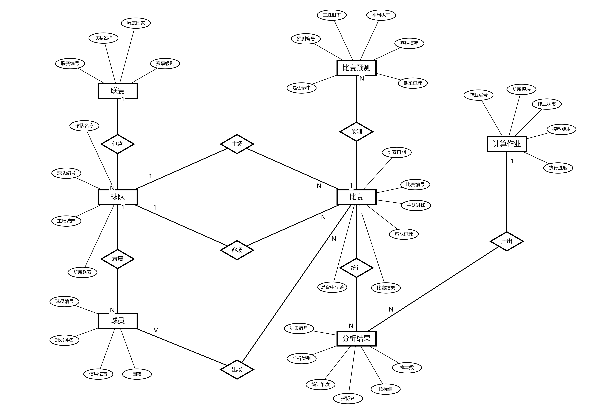
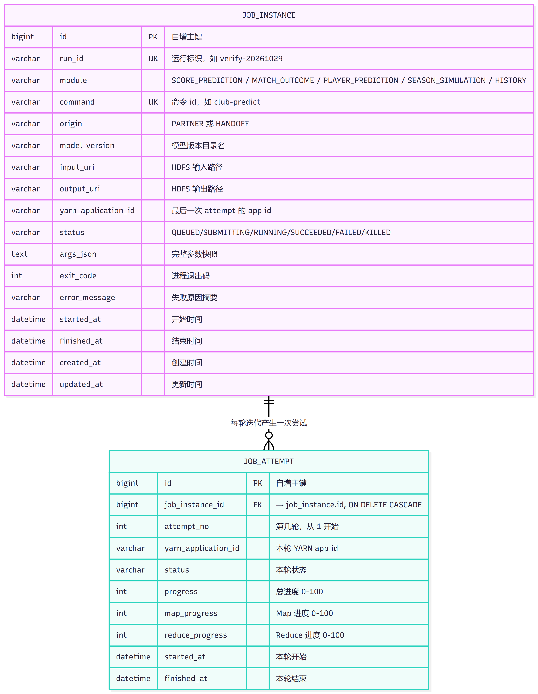
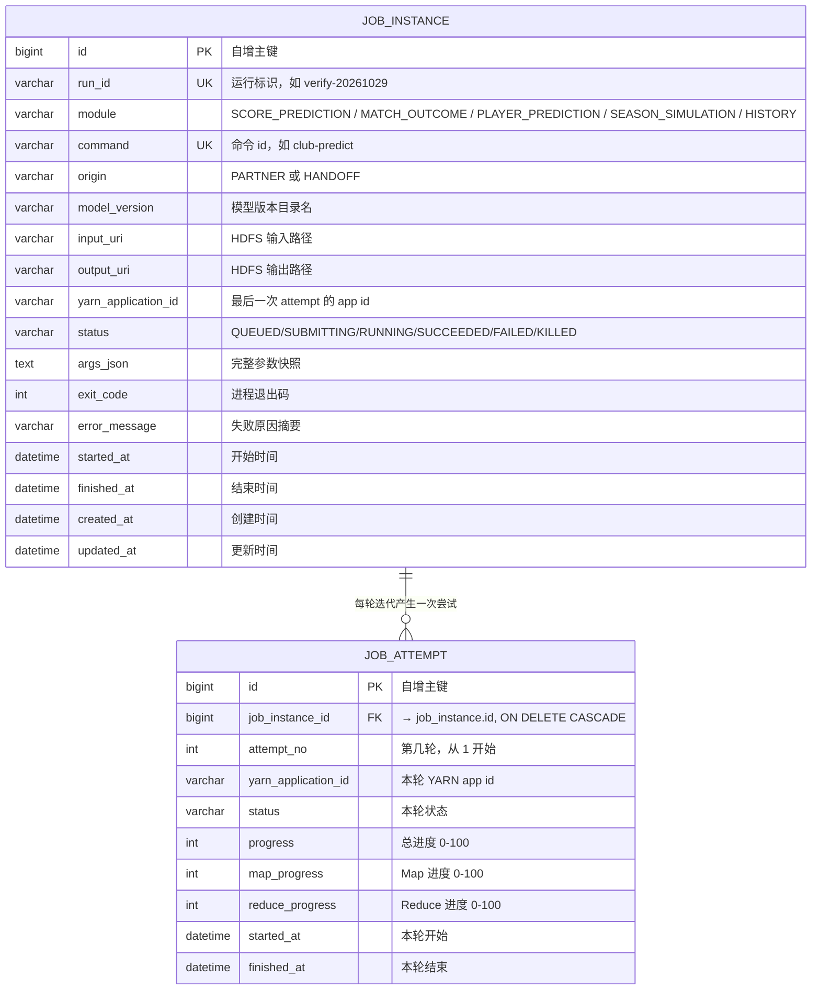
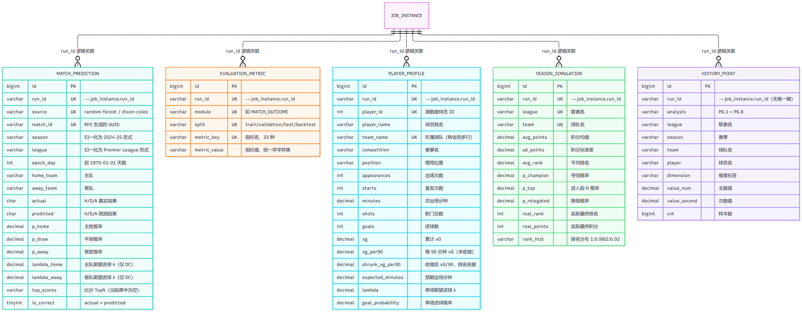
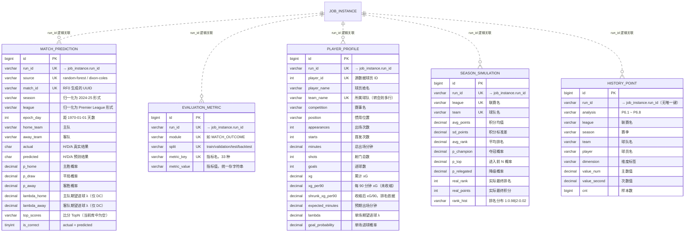
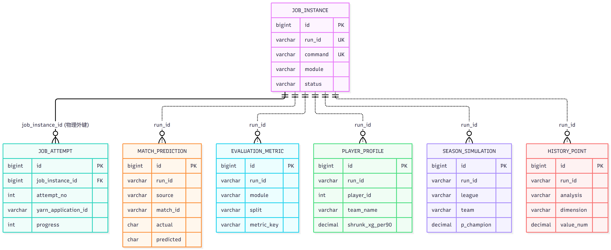
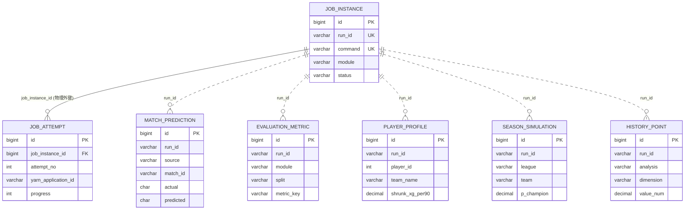

# FootPred 数据模型

本文件包含两层模型，用途不同：

| 层次 | 内容 | 用途 |
|---|---|---|
| **概念模型** | 只含实体、属性、联系基数，不含字段类型与索引 | 需求沟通、论文设计章节、答辩讲解 |
| **物理模型** | 7 张表的实际实现（字段、类型、主外键、索引、约束） | 开发实现、数据库建表依据、验收 |

物理模型部分的结构信息由 `information_schema` 实际导出核对，与
`docs/DATA-DICTIONARY.md` 第四节逐字段一致。

---

# 第一部分 概念模型

## 0. 记法说明（Chen 记号法）

本图采用教材通用的 Chen 记号，三种图形对应 ER 模型的三要素：

| 图形 | 含义 | 配色 | 图中实例 |
|---|---|---|---|
| **矩形** | 实体（Entity） | 深靛蓝实心 + 白字 | 联赛、球队、球员、比赛、比赛预测、分析结果、计算作业 |
| **椭圆** | 属性（Attribute） | 浅灰底 + 灰蓝描边 | 联赛编号、球队名称、主胜概率……共 35 个 |
| **菱形** | 联系（Relationship） | 琥珀黄实心 + 深棕字 | 包含、隶属、主场、客场、出场、预测、统计、产出 |
| 直线 | 实体—属性、实体—联系之间的连接 | 灰细线 / 棕粗线 | 无箭头，只表示归属 |
| 圆角标签 | 联系两端的**基数** | 白底青框 | 标在靠近对应实体的一端 |

**三处辅助编码**（不干扰"三要素"主色）：

1. **虚线分区框**——按业务层把实体分组：组织层（联赛/球队/球员，浅蓝）、事件层（比赛/比赛预测/分析结果，浅橙）、产出层（计算作业，浅绿）。
2. **实体左上角色条**——与所属分区同色，单个实体脱离分区时也能看出归属。
3. **图例**——位于右下角空白区，说明三种图形与基数标签的含义。

**设计原则**：颜色只用于区分**三要素**，不按实体逐个上色。若每个实体一种颜色，读者会误以为颜色在编码更多信息，反而削弱"矩形/椭圆/菱形"的形状语义。

**注意概念模型与物理模型的字段差异**：概念模型里的属性是"业务上关心的事实"，
不带数据类型、不带主键标记。`联赛编号`、`球队编号` 等虽然名字像主键，但在图中
与其他属性一样画成普通椭圆——**主键的下划线标记属于物理层**，见第二部分。

## 1. 实体说明

| 实体 | 业务含义 | 标识属性 | 其余属性 | 属性数 |
|---|---|---|---|---|
| 联赛 | 赛事组织单位 | 联赛编号 | 联赛名称、所属国家、赛事级别 | 4 |
| 球队 | 参赛主体 | 球队编号 | 球队名称、主场城市、所属联赛 | 4 |
| 球员 | 参赛个体 | 球员编号 | 球员姓名、惯用位置、国籍 | 4 |
| 比赛 | 一场对阵 | 比赛编号 | 比赛日期、主队进球、客队进球、比赛结果、是否中立场 | 6 |
| 比赛预测 | 对比赛的赛前推断 | 预测编号 | 主胜概率、平局概率、客胜概率、期望进球、是否命中 | 6 |
| 分析结果 | 历史统计产出 | 结果编号 | 分析类别、统计维度、指标名、指标值、样本数 | 6 |
| 计算作业 | 产生上述结果的计算过程 | 作业编号 | 所属模块、作业状态、模型版本、执行进度 | 5 |

合计 **7 个实体、35 个属性**，与图中椭圆数量一一对应。

## 2. 联系说明

| 联系（菱形） | 连接实体 | 基数 | 含义 |
|---|---|---|---|
| 包含 | 联赛 — 球队 | 1 : N | 一个联赛包含多支球队，每队归属一个联赛 |
| 隶属 | 球队 — 球员 | 1 : N | 一支球队拥有多名球员 |
| 主场 | 球队 — 比赛（第一处） | 1 : N | 比赛的主队那一方 |
| 客场 | 球队 — 比赛（第二处） | 1 : N | 比赛的客队那一方 |
| 出场 | 球员 — 比赛 | M : N | 一名球员参加多场比赛，一场比赛有多名球员出场 |
| 预测 | 比赛 — 比赛预测 | 1 : N | 一场比赛可有多条预测记录（不同模型、版本） |
| 统计 | 比赛 — 分析结果 | 1 : N | 一场比赛参与多条历史统计 |
| 产出 | 计算作业 — 分析结果 | 1 : N | 一次计算作业产出多条分析结果 |

合计 **8 个联系、16 个基数标注**（每个联系两端各一个），与图中菱形数量一致。

> `主场` 与 `客场` 是两个独立的联系菱形，而不是一个联系的两条线。
> 这样画是为了让"球队以主队身份参赛"与"以客队身份参赛"两个不同角色各自带基数，
> 避免合并后无法区分。

## 3. 两个建模决策

**① 为什么「射门事件」「出场记录」不在概念模型中**

它们是**弱实体**——不能独立存在，必须依附于（球员，比赛）这一组合。
在概念模型中，用 `M : N` 的一方“出场 / 射门”承载即可；到了物理模型，
这部分明细并未单独建表，而是由模块三聚合到 `player_profile`（见 §5.2 的设计取舍）。

**② 为什么「球队 — 比赛」有两条联系**

主场与客场语义不同，但基数相同（都是 1 : N）。概念模型画两条线表达两个角色，
物理模型中则体现为 `match_prediction` 表里的 `home_team` 与 `away_team` 两个字段。

---

# 第二部分 物理模型

以下内容为数据库实现细节，对应 `backend/deploy/sql/schema.sql`，
并在虚拟机 `footpred` 库上用 `information_schema` 实测核对。

## 4. 表结构 ER 图

### 4.1 作业调度核心（2 实体，唯一有物理外键的部分）

**唯一物理外键**：`job_attempt.job_instance_id → job_instance.id`，带 `ON DELETE CASCADE`。
理由：attempt 不能脱离 job 存在，删除作业记录时轮次记录应一并清除。

**唯一键**：

| 表 | 唯一键 | 实测索引名 |
|---|---|---|
| `job_instance` | `(run_id, command)` | `uk_run_command` |
| `job_attempt` | 无（仅 `idx_job` 普通索引） | — |

### 4.2 结果数据（5 实体，全部通过 `run_id` 逻辑关联）

**为什么用虚线（`||..o{`）而不是实线**：这五张表在库里**没有建立外键约束**，
关联只靠 `run_id` 字符串在应用层保证。Mermaid 的 `..` 表示弱关联，与实线的物理外键区分。

### 4.3 全图（7 张表的关系拓扑）

全图只画实体与连线，字段明细见 §4.1 / §4.2——7 张表的字段全部展开会让图过宽难以阅读。

**读图要点**：

- `JOB_INSTANCE` 是唯一被多条线指向的实体，是全局根。
- 实线一条（`||--o{`）：`job_instance → job_attempt`，库中真实存在 `FOREIGN KEY ... ON DELETE CASCADE`。
- 虚线五条（`||..o{`）：`job_instance → 五张结果表`，库中**没有**外键约束，靠 `run_id` 字符串关联。
- 五张结果表之间**互不相连**——它们只在 `run_id` 这一层汇聚，彼此没有直接关系。
  例如 `match_prediction` 与 `evaluation_metric` 虽然语义上"预测结果被评估"，但库里没有字段把它们直接连起来，
  要联表只能通过 `run_id`。这是长表 + 逻辑关联带来的真实代价，答辩时要能说清楚。

### 4.4 图例

Mermaid ER 图的连线两端符号是标准鸦爪记法：

| 符号 | 含义 |
|---|---|
| `&#124;&#124;` | 恰好一个（1） |
| `o{` | 零个或多个（N） |
| `--` | 物理外键（库中真实存在 `FOREIGN KEY` 约束） |
| `..` | 逻辑关联（无外键约束，靠 `run_id` 字符串在应用层维护） |

`JOB_INSTANCE &#124;&#124;--o{ JOB_ATTEMPT` 读作：
**一次作业提交对应零到多条轮次记录**（物理外键，级联删除）。

`JOB_INSTANCE &#124;&#124;..o{ MATCH_PREDICTION` 读作：
**一次作业提交对应零到多条比赛预测**（逻辑关联，无外键）。

---

## 5. 实体关系说明（物理层）

### 5.1 七张表的分工

| 表 | 字段数 | 索引数 | 当前行数 | 角色 | 关系类型 |
|---|---:|---:|---:|---|---|
| `job_instance` | 17 | 5 | 6 | **根实体**，所有结果的归属 | 被 6 张表引用 |
| `job_attempt` | 10 | 2 | 4 | 迭代训练的逐轮明细 | 物理外键 → `job_instance` |
| `match_prediction` | 18 | 4 | 1 752 | 比赛结果预测 | 逻辑关联 `run_id` |
| `evaluation_metric` | 6 | 3 | 50 | 评估指标长表 | 逻辑关联 `run_id` |
| `player_profile` | 18 | 3 | 7 547 | 球员 xG 画像 | 逻辑关联 `run_id` |
| `season_simulation` | 13 | 3 | 192 | 赛季模拟概率 | 逻辑关联 `run_id` |
| `history_point` | 11 | 3 | 5 420 | 八项历史分析长表 | 逻辑关联 `run_id` |
| **合计** | **93** | **23** | — | — | — |

### 5.2 为什么 `job_instance` 是中心实体，却没有全部建外键

所有结果表都用 `run_id` 关联到 `job_instance`，但**只有 `job_attempt` 建了物理外键**，
其余五张都是逻辑关联。这是有意的：

1. **`run_id` 在算法包侧是目录名**（`train-20261012-210109`）。作业失败或目录被手工清理后，
   结果数据可能先于作业记录被删除；硬外键会让清理动作失败，或者级联删掉本该保留的结果。
2. **导入接口允许「只导结果、不导作业记录」**。对方只给了一个 export 目录、
   没有作业元数据时，外键会直接阻止导入。本项目整合两个独立交付包，
   这种情况是真实存在的（`prep-225732`、`m3-092841` 等 run 就是先有产物、后补作业记录）。
3. **结果数据是只读分析产物**，不像业务系统那样有并发一致性要求；
   `run_id` 不一致的后果是"查不到"，不会污染数据。

因此关联由 `run_id` 字符串承担，应用层保证一致性。代价是数据库层面查不出孤儿行，
所以后端导入前会先按 `run_id` 删除旧行再插入（幂等导入）。

### 5.3 为什么 `job_attempt` 反过来必须建物理外键

`job_attempt` 与结果表的性质不同：它是**作业执行过程的附属记录**，
业务上没有"没有作业却有轮次"的合法场景。因此：

- 建外键 `fk_attempt_job`，`ON DELETE CASCADE`；
- 删除作业记录时，轮次记录一并清除，不留孤儿。

### 5.4 1:N 而非 1:1 的关键点

`job_instance` 与 `yarn_application_id` 是 **1:N**：

- `train` 命令内部是 T 轮 L-BFGS 迭代，**每轮一个独立 YARN application**；
- `job_instance` 只保留最后一次的 app id（便于列表展示）；
- 完整历史在 `job_attempt` 里逐轮记录。

若按"一个作业一个 applicationId"建模，训练进度永远显示不出来。

### 5.5 唯一键的设计依据（实测索引名）

| 表 | 唯一键 | 索引名 | 为什么这样设计 |
|---|---|---|---|
| `job_instance` | `(run_id, command)` | `uk_run_command` | 同一 run 目录下可以有多个命令（predict + evaluate） |
| `match_prediction` | `(run_id, source, match_id)` | `uk_run_match` | 同一 run 下 DC 与 RF 两套预测共存 |
| `evaluation_metric` | `(run_id, module, split, metric_key)` | `uk_run_split_key` | 模块二与模块三都有 test 指标，需按 module 区分 |
| `player_profile` | `(run_id, player_id, team_name)` | `uk_run_player_team` | **球员会转会**，只按 player_id 会拒绝合法数据 |
| `season_simulation` | `(run_id, league, team)` | `uk_run_league_team` | 跨联赛队伍可能重名 |
| `history_point` | 无唯一键 | — | 长表，同一 run 下多行同维度是正常的 |

`player_profile` 那条尤其关键：reducer 按 `(team, match, player)` 出 key，
一个球员同赛季换队会产生多行，实测源数据合并后为 **7 547 个 (球员, 球队) 组合**。

`history_point` 没有唯一键是有意的：P6.3 的同一 `(league, season)` 下就有 7 个时间段行，
强行加唯一键会拒绝正常数据。

### 5.6 索引的分工

| 索引 | 表的 | 列 | 服务的查询 |
|---|---|---|---|
| `idx_status` | `job_instance` | `status` | 前端按状态筛选作业列表 |
| `idx_module_created` | `job_instance` | `module`, `created_at` | 按模块分组、按时间倒序分页 |
| `idx_app` | `job_instance` | `yarn_application_id` | 从 YARN 页面反查作业 |
| `idx_job` | `job_attempt` | `job_instance_id` | 展开某作业的全部轮次 |
| `idx_season_league` | `match_prediction` | `season`, `league` | 按赛季+联赛筛选预测结果 |
| `idx_teams` | `match_prediction` | `home_team`, `away_team` | 某队主/客场战绩查询 |
| `idx_run` | `evaluation_metric` | `run_id` | 取某次运行的全部指标 |
| `idx_rank` | `player_profile` | `run_id`, `shrunk_xg_per90` | 射手榜 TopN（**必须用收缩值排序**） |
| `idx_champ` | `season_simulation` | `run_id`, `p_champion` | 夺冠概率 TopN |
| `idx_run_analysis` | `history_point` | `run_id`, `analysis` | 按分析编号取数（**防止跨分析混淆**） |
| `idx_leagueseason` | `history_point` | `league`, `season` | 跨分析的联赛-赛季切片 |

两个值得注意的点：

- **`idx_rank` 用的是 `shrunk_xg_per90` 而不是 `xg_per90`**。出场时间少的球员原始 xG/90
  波动极大，直接排序会冒出"替补射门一次就登顶"的假榜。收缩值向位置均值回归，才是可比的。
- **`idx_run_analysis` 把 `analysis` 放进索引前两位**。`history_point` 是长表，
  八项分析混在一起，不带 `analysis` 的查询会跨分析混淆（比如把 P6.3 的进球数当成 P6.7 的分差）。

---

## 6. 数据流转（从文件到表）

三个关键设计点：

1. **HDFS 是唯一计算边界**：所有 MapReduce 输入输出都在 HDFS，服务层不参与计算。
2. **导出是显式一步**：不让后端直连 HDFS，避免 Spring Boot 与 Hadoop 客户端的依赖冲突；
   导出产物同时满足课程"结构化数据"的要求。
3. **导入幂等**：每次导入先删该 run_id 的旧行再批量插入，重复导入不产生重复数据。

---

## 7. 与课程要求的对应关系

| 课程要求 | 本项目实现 |
|---|---|
| "convert the data from file format into structured data" | `match_prediction` 等 7 张表 + JSON 接口 |
| "storing it in database tables, generating JSON files" | MySQL 7 表 93 字段 + `/api/results/*` |
| "use Hadoop API, HBase API, or Java API to retrieve results from HDFS" | 用 `hdfs dfs -cat` 导出（等价于 Hadoop FileSystem API），未直接用 HBase |

**关于 HBase**：课程提到 HBase，但两份算法交付包都只用 HDFS 文件，未使用 HBase 表。
虚拟机装了 HBase 2.4.18 但项目未调用。如果课程强制要求 HBase，需要额外做一层
HDFS → HBase 的导入，这是当前**唯一与环境相关的缺口**。

---

## 8. 与数据字典的一致性

本文件的物理模型与 `docs/DATA-DICTIONARY.md` 第四节共用同一套核对结果：

| 核对项 | 结果 |
|---|---|
| 表数 | 7 张（`SHOW TABLES` 实测） ✅ |
| 字段总数 | 93（`information_schema.COLUMNS` 实测） ✅ |
| 索引数 | 23（`COUNT(DISTINCT INDEX_NAME)` 按表汇总） ✅ |
| 物理外键 | 1 个（`fk_attempt_job`，`KEY_COLUMN_USAGE` 实测） ✅ |
| 唯一键 | 5 个业务唯一键 + 7 个主键 ✅ |
| 字段名/顺序/类型/可空性 | 与数据字典逐字段比对，0 处不一致 ✅ |
| 表注释 | 7 张表全部非空 ✅ |
