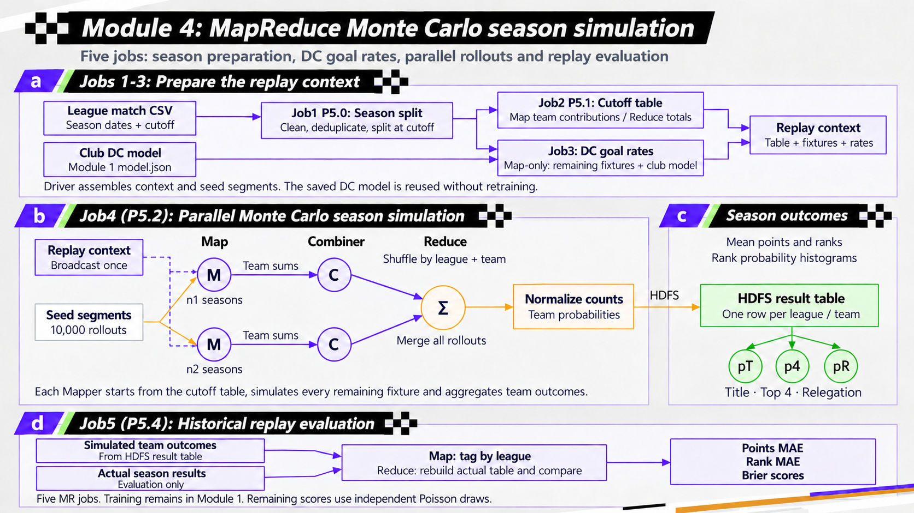

# 模块四五 Job 版本接入

## 变更与兼容性

接入搭档提供的 FootPred_Module4_FiveJobs_20261030.zip。模拟内核不变，原 Driver 准备与评估工作扩展为五个实际提交的 Job：

| 顺序 | 算法编号 | 工作 |
|---|---|---|
| 1 | P5.0 | Map解析筛选，Reduce去重，分出已赛、剩余无比分赛程、评估真值 |
| 2 | P5.1 | Map/Combiner/Reduce 汇总截止日前球队状态 |
| 3 | P5.3 | Map-only 加载已有DC模型计算剩余比赛λ |
| 4 | P5.2 | Map并行模拟，Combiner局部求和，Reduce汇总概率 |
| 5 | P5.4 | 按联赛关联模拟结果和实际比赛，重建真实积分榜并评估 |

执行顺序是 P5.0→P5.1→P5.3→P5.2→P5.4；P5.2编号为兼容旧版本而保留。一次Web提交仍是一条simulate运行记录，内部提交五个Hadoop Job，不能在接口中把它伪造为五次独立业务请求。

## 本仓库改动

- `algorithms/module4/`：搭档提供的完整算法源码、POM和测试，可独立构建；不修改其模拟逻辑。
- 作业目录新增simulate的run-id参数，后端将request.runId传给算法，避免数据库运行编号与HDFS目录不一致；冲突编号拒绝。
- 新增配置 `footpred.jar.partner.module4`，simulate优先使用专用新JAR，其他搭档命令继续走原partner JAR。未配置时仍回落partner JAR，使用前必须确认它也是五Job版本。
- 预计时间更新为180秒，只作界面提示。搭档附带的真实YARN日志为177.5秒，其他机器时间可能不同。
- 本地进程执行器可以更新到后续applicationId；轮询可能跳过很快完成的中间应用，完整五阶段凭据以算法job_manifest.tsv和YARN为准，不能保证页面attempt数始终等于5。
- 默认simulate结果与实际积分榜切换至同一新run的导出文件。最终96队模拟TSV与旧文件逐行一致，结果格式仍为11列，实际榜8列，现有解析器兼容。
- 新增P5.4专用三列格式解析（league、metric、value），赛季模拟页面显示五个联赛的积分MAE、排名MAE、夺冠/前列/降级Brier；按联赛筛选。自定义simulation location不附带默认run的评估，避免来源混用。
- `POST /api/admin/import/evaluation/{runId}` 在module=SEASON_SIMULATION时使用专用解析器，以league作为split保存，每个联赛6项，共30条指标，无需修改数据库表。

## Linux执行部署

Web JAR和Hadoop算法JAR是两个不同文件。新算法可从源码构建：

```bash
mvn -f algorithms/module4/pom.xml package
```

或使用搭档已提供的 `footpred-module4-fivejobs.jar`，SHA256：

```text
82b8a9bccef7a3e12574502f8b7ba15f6cad2b507d835bcb13bdbedcc8cc393f
```

将算法JAR放在实际执行hadoop命令的Linux主机，例如 `/job/app/footpred-module4-fivejobs.jar`，在后端配置中设置：

```properties
footpred.jar.partner.module4=/job/app/footpred-module4-fivejobs.jar
```

启用作业执行还需要MySQL、Hadoop客户端、HDFS/YARN以及已有DC模型和比赛输入。Web后端在Windows以local模式运行时，该Linux路径不可直接执行。现有ClusterGateway支持密钥认证的OpenSSH远程执行，可按 WEB_DATASET_UPLOAD_MR.md 配置cluster.mode=ssh；或者直接在Linux部署后端。远程执行能力目前只完成离线测试，本次未连接真实集群验收。

直接在Linux执行示例，路径按实际HDFS修改：

```bash
hadoop jar /job/app/footpred-module4-fivejobs.jar simulate \
  --input /FootPred/data/leagues/results_leagues.csv \
  --model /FootPred/module1/clubs/runs/leagues_v1/model.json \
  --workdir /FootPred/module4 --run-id fivejobs-demo-NEW \
  --season-start 2025-08-01 --cutoff 2026-01-01 --season-end 2026-06-30 \
  --total-sims 10000 --maps 2 --seed 42
```

每次使用新的run-id。输出在workdir/runs/run-id下：simulation、real_final_table.tsv、p5-4-evaluation、job_manifest.tsv等。需将同一run的模拟、实际榜和评估一起导出，再调整相应Web配置，不能只替换其中一个文件。

## 本机展示与MySQL

默认数据位置为 `data/export/runs/module4-fivejobs-20261030/`。来源信息见provenance.json及job_manifest.tsv，搭档提供的五Job成功日志不代表在本机重新运行了Hadoop。

```bash
curl -X POST http://127.0.0.1:8080/api/admin/import/evaluation/module4-fivejobs-20261030 \
  -H 'Content-Type: application/json' \
  -d '{"module":"SEASON_SIMULATION","location":"runs/module4-fivejobs-20261030/evaluation.tsv"}'
```

模拟结果和实际榜分别读取默认TSV；MySQL的指标导入独立于前端读取。无需打开HDFS即可展示已导出的新结果和指标。旧RF评估页继续显示模块二指标，避免混用三分类指标与赛季回放指标。

原有源码统计34个Job类型时，本次新增4种类型，因此在相同计数口径下为38种；同一个Job执行100次仍只算一种定义。该统计不等同于一次演示的Job运行次数。

## 评估边界

P5.4不用于重新训练。改变剩余比赛真实比分不应影响P5.1、P5.3和模拟概率，但严格无泄漏回测还要求DC模型训练数据不晚于cutoff。本包复用旧模型，本次未验证该训练截止时间；因此MAE/Brier可用于展示本次回放结果，不能据此宣称严格样本外预测性能。

## 本次接入验收

真实本机MySQL成功导入30条联赛指标，与API数值逐项一致。最终测试数量见随包verification报告。本次没有在本机Linux重新运行五个MR Job；Hadoop运行证据来自搭档的提交包。

本次后端合并报告共143项：139通过、4跳过，无失败；前端20项通过。浏览器中英文评估表及联赛筛选通过。


